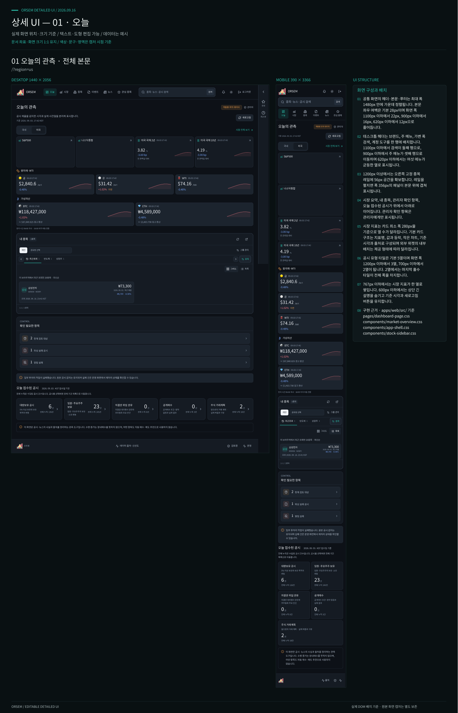

# Orsem

## 💬 프로그램 소개

`Orsem`은 국내외 공시, 내부자 소유변동, 시장 가격과 뉴스 메타데이터를 한곳에서 살펴보는 개인용 웹 서비스입니다. 공시 탐색, 종목 차트, 개인·공유 관심 목록, 통합 검색과 수집 운영 기능을 하나의 프로젝트로 운영합니다.

원본과 출처, 이용 권리, 사건 시점을 함께 확인할 수 있도록 설계했습니다. 보유 수량 증가를 장내매수로 자동 판단하지 않으며, 자동 매수·매도 추천이나 주문 기능을 제공하지 않습니다.

[Figma UI 문서](https://www.figma.com/design/3ywykwXQtzJxqu7zn2YwlO/orsem-ui?node-id=0-1) · [편집 가능한 배너](https://www.figma.com/design/3ywykwXQtzJxqu7zn2YwlO/orsem-ui?node-id=99-2) · [전체 문서 안내](docs/README.md) · [웹 화면 안내](apps/web/README.md)

## 📁 프로젝트 구성

| 경로                  | 역할                               |
| --------------------- | ---------------------------------- |
| `apps/api/`           | NestJS REST API, 인증, 관리자 기능 |
| `apps/web/`           | React 운영 대시보드와 공개 화면    |
| `apps/worker/python/` | Python 수집·파싱·알림 워커         |
| `apps/discord-bot/`   | Discord 조회 명령과 알림           |
| `packages/contracts/` | Zod 계약과 공통 도메인 용어        |
| `packages/database/`  | MySQL 엔티티와 마이그레이션        |
| `integrations/`       | MessengerBotR API2 브리지          |
| `scripts/`            | 검증·운영 CLI와 개발 도구          |
| `deploy/`             | 검토 후 적용하는 배포 예시         |
| `docs/`               | 구조·데이터·권리·보안·운영 문서    |

## 🛠️ 활용 기술 스택

&nbsp;
&nbsp;
&nbsp;
&nbsp;
&nbsp;
&nbsp;
&nbsp;
&nbsp;


API·웹·Discord와 공통 TypeScript 패키지는 npm workspaces로 관리합니다. Python 워커는 BullMQ 작업을 처리하고, MySQL은 수집 데이터와 도메인 정보를, Redis는 큐와 세션을 저장합니다. API 계약은 Zod로 검증하며 DB 스키마는 TypeORM 마이그레이션으로 관리합니다.

## ✨ 주요 기능

- **오늘·시장 관측** — 시장 지표, 관심 종목 소식, 오늘 접수된 공시와 수집 상태를 확인합니다.
- **공시 탐색과 검토** — 유형별 공시 목록, 상세 정보, 정정 연결과 사람 검토 상태를 살펴봅니다.
- **종목 화면** — 가격 차트와 공시·뉴스 이벤트를 출처·시점과 함께 확인합니다.
- **관심 그룹과 통합 검색** — 개인·공유 관심 목록을 관리하고 종목·공시·뉴스 메타데이터를 검색합니다.
- **운영 상태 확인** — 수집 소스, 실행 이력, 큐 적체와 실패·재시도 정보를 확인합니다.
- **알림 연동** — Discord 봇과 MessengerBotR 브리지에서 조회와 알림을 지원합니다.

## ⚙️ 환경 설정 및 실행

### 사전 요구사항

- Node.js 24 이상, npm 11 이상
- 전체 서비스 실행 시 Python 3.12, MySQL, Redis
- 실제 데이터 소스에 연결할 자격 증명은 저장소 외부에 별도 관리

명령은 프로젝트 루트에서 실행합니다. 데이터는 `../orsem-data`, 비밀 설정은 `../.config/orsem`을 기본 배치 예시로 사용합니다. 실제 비밀 값은 `.env`나 Git에 넣지 않고 [자격 증명 관리](docs/CREDENTIALS.md)에 따라 주입합니다.

### 프론트엔드 미리보기

```bash
cp .env.example .env
npm install
npm run dev:web
```

개발용 `VITE_FIXTURE_MODE=true` 설정으로 모의 데이터를 볼 수 있습니다. 운영 빌드에서는 테스트 데이터 어댑터를 사용하지 않습니다.

### API·워커 실행

MySQL·Redis와 [Python 실행 환경](docs/PYTHON_WORKER.md#실행-환경)을 준비하고 자격 증명을 설정한 뒤, 마이그레이션을 먼저 적용합니다.

```bash
npm run build:packages
npm run db:migrate
```

API와 워커는 각각 별도 터미널에서 실행합니다.

```bash
npm run dev:api
```

```bash
python3 scripts/worker.py start
```

DB 스키마 변경은 마이그레이션을 사용하며 TypeORM `synchronize`는 항상 `false`로 유지합니다. 개발 실행과 운영 wheel 실행의 차이는 [워커 안내](apps/worker/README.md)를 참고하세요.

## 🔗 URL 규칙

다음은 승인 회원의 주요 화면입니다. 비로그인 이용자는 공개 시장·종목·뉴스 화면을 이용하며, 같은 주소에서도 로그인과 권한 상태에 따라 표시되는 내용이 달라집니다.

| 경로                       | 화면                            |
| -------------------------- | ------------------------------- |
| `/`                        | 오늘의 공시·시장·관심 종목 관측 |
| `/markets`, `/markets/:id` | 시장 지표와 상세 차트           |
| `/search?q=...`            | 종목·공시·뉴스 통합 검색        |
| `/events`, `/events/:id`   | 공시 이벤트 목록과 상세 정보    |
| `/companies/:codeOrTicker` | 종목 가격·공시·뉴스 관측        |
| `/watchlist`               | 개인·공유 관심 그룹과 종목      |
| `/reviews`, `/operations`  | 관리자 검토함과 수집 운영 상태  |
| `/login`                   | 회원 로그인과 승인 상태 확인    |

메뉴·접근 권한과 화면별 동작은 [웹 안내](apps/web/README.md)와 [종목 화면](docs/COMPANY_SCREEN.md)에 정리합니다.

## 📡 데이터·이용 원칙

- **공시 유형 구분** — D001 대량보유, D002 임원·주요주주 소유변동, D003 의결권 위임 권유, D004 공개매수, D005 향후 거래계획을 구분합니다. 거래계획과 실제 소유변동을 같은 사건으로 해석하지 않습니다.
- **출처와 시점 보존** — 원본 필드, 출처, 이용 권리, 사건일, 발행·접수일, 최초 관측 시각을 구분해 보존합니다. 사용자 시각은 KST, 저장 시각은 UTC를 사용하며 날짜 전용 원본 값은 날짜로 유지합니다.
- **허용된 뉴스 메타데이터** — 제목·제공 요약 등 허용된 메타데이터만 다루며 기사 본문을 요청하거나 저장하지 않습니다.
- **소스별 연결 관리** — 종목 가격 차트와 현재가는 토스증권을 사용합니다. 자격 증명이 없는 커넥터는 해당 연동만 비활성화하고 운영 환경에는 fixture 데이터를 자동 삽입하지 않습니다.

수집 범위와 제공자별 허용 조건은 [소스 안내](docs/SOURCES.md)와 [이용 권리](docs/RIGHTS.md)를 따릅니다.

## 📝 API·프로젝트 문서

- **API 계약** — [REST API](docs/API.md), [공통 데이터 구조](docs/DATA_MODEL.md)
- **시스템 구조** — [아키텍처](docs/ARCHITECTURE.md), [Python 워커](docs/PYTHON_WORKER.md)
- **수집·파싱** — [파싱 무결성](docs/PARSER_INTEGRITY.md), [SEC 수집](docs/SEC_COLLECTION.md), [뉴스 수집](docs/NEWS_COLLECTION.md)
- **전체 문서** — [현행 가이드와 날짜별 기록](docs/README.md)

## 🚀 검증·배포 문서

운영 프로세스가 저장소의 `dist`를 사용 중이라면 격리 복사본에서 검사와 빌드를 실행합니다. 준비한 Python 가상환경을 지정한 뒤 다음 명령을 실행합니다.

```bash
export ORSEM_WORKER_PYTHON="$PWD/.venv/bin/python"
npm run check:isolated
```

문서 경로와 상대 파일 링크는 `npm run check:docs`로 확인합니다.

- [테스트 전략](docs/TESTING.md) — 검사 명령과 테스트 환경
- [배포 가이드](docs/DEPLOYMENT.md) — 실행 환경, 마이그레이션, 서비스 적용 절차
- [운영 가이드](docs/OPERATIONS.md) — 소스 연결과 장애 점검
- [자격 증명 관리](docs/CREDENTIALS.md) — 외부 비밀 파일과 서비스별 주입 방법

## 🖥️ Figma UI 문서

[전체 Figma 문서 열기](https://www.figma.com/design/3ywykwXQtzJxqu7zn2YwlO/orsem-ui?node-id=0-1)

아래는 Figma에서 정리한 오늘 화면의 데스크톱·모바일 상세 UI와 배치 설명입니다. 화면 구성은 2026-09-16 기준이며 데이터는 모의 값입니다. 로고는 2026-10-28에 합장한 손과 상승 막대 아이콘으로 갱신했습니다.

<details>
<summary>오늘 화면의 상세 UI 보드 펼쳐 보기</summary>



</details>
